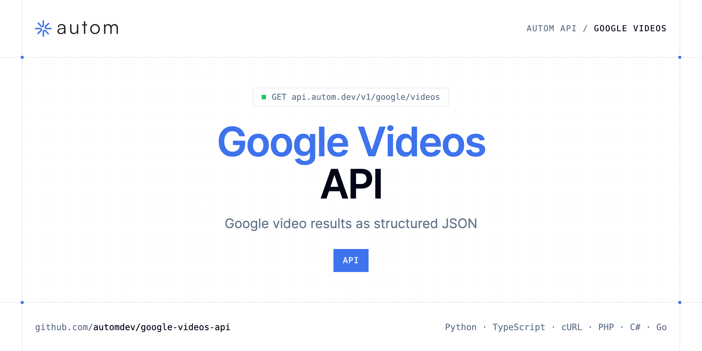

<p align="center">
  <a href="https://www.autom.dev"></a>
</p>

# Google Videos API

[](https://discord.gg/CFj3ph8aHU) [](https://app.autom.dev/register) [](https://docs.autom.dev) [](LICENSE)

The **Autom Google Videos API** returns Google video results — titles, links, platforms, durations — as structured JSON.

- **Google Videos API** — Search Google Videos via API and retrieve structured video results with metadata.

Use it for video SEO, content research or competitive analysis.

| Endpoint | Request | Credits |
|---|---|---|
| [Google Videos API](#google-videos-api) | `GET /v1/google/videos` | 1 |

## Table of contents

- [How it works](#how-it-works)
- [Google Videos API](#google-videos-api)
- [Code examples in other languages](#code-examples-in-other-languages)
- [Use cases](#use-cases)
- [Why Autom?](#why-autom)
- [FAQ](#faq)
- [Related repositories](#related-repositories)
- [Support](#support)

## How it works

1. **Create a Autom account** and copy your API key from the [dashboard](https://app.autom.dev/register).
2. **Call `https://api.autom.dev`** with the header `x-api-key: YOUR_API_KEY`.
3. **Use the result** in your app — no infrastructure to run.

```bash
export AUTOM_API_KEY="your-api-key"
pip install requests        # Python
# TypeScript: Node.js 18+ (native fetch), run with `npx tsx file.ts`
```

## Google Videos API

Search Google Videos via API and retrieve structured video results with metadata.

`GET https://api.autom.dev/v1/google/videos` · **1 credit per request** · [API reference](https://app.autom.dev/openapi)

### Request parameters

| Parameter | In | Type | Required | Description |
|---|---|---|---|---|
| `query` | query | string | ✅ | The search query you want to run on Google Videos. |
| `location` | query | string | — | Human-readable location to originate the search from. Note: `location` and `uule` cannot be used together. |
| `uule` | query | string | — | Google encoded location parameter. Note: `uule` and `location` cannot be used together. |
| `gl` | query | string | — | Country to use for the search (two-letter country code). |
| `hl` | query | string | — | Language to use for the search (two-letter language code). |
| `page` | query | number | ✅ | Page number for pagination (1 = first page). |
| `num` | query | number | — | Maximum number of results per page (e.g. 10). |
| `safe` | query | string | — | Adult content filter. `active` enables Google SafeSearch; `off` disables it. Omit to use Google default. |

### Python example

```python
import os

import requests

API_KEY = os.environ["AUTOM_API_KEY"]
HEADERS = {"x-api-key": API_KEY}

response = requests.get(
    "https://api.autom.dev/v1/google/videos",
    headers=HEADERS,
    params={
        "query": "paris",
        "page": "1",
    },
    timeout=120,
)
response.raise_for_status()

data = response.json()
print(data)
```

### TypeScript example

```typescript
type GoogleVideosApi = {
  organic_results?: {
    date?: string;
    link?: string;
    title?: string;
    domain?: string;
    source?: string;
    channel?: string;
    snippet?: string;
    duration?: string;
    position?: number;
    video_id?: string;
  }[];
  search_parameters?: {
    q?: string;
    gl?: string;
    hl?: string;
    page?: number;
    engine?: string;
  };
};

const headers = { "x-api-key": process.env.AUTOM_API_KEY!, "Content-Type": "application/json" };

const params = new URLSearchParams({
  "query": "paris",
  "page": "1",
});

const response = await fetch(`https://api.autom.dev/v1/google/videos?${params}`, { headers });
if (!response.ok) throw new Error(`HTTP ${response.status}: ${await response.text()}`);

const data = (await response.json()) as GoogleVideosApi;
console.log(data);
```

### Output example

Example response from the API reference, abridged.

```json
{
  "organic_results": [
    {
      "date": "3 days ago",
      "link": "https://www.youtube.com/watch?v=aPrC0eXns9w",
      "title": "Why Paris Is Extending One Of Its Metro Lines...",
      "domain": "www.youtube.com",
      "source": "YouTube",
      "channel": "The Tim Traveller",
      "snippet": "Paris is about to open its first urban cable car line.",
      "duration": "4:19",
      "position": 2,
      "video_id": "aPrC0eXns9w"
    }
  ],
  "search_parameters": {
    "q": "paris",
    "gl": "us",
    "hl": "en",
    "page": 1,
    "engine": "google_videos"
  }
}
```

### Response fields

| Field | Type | Description |
|---|---|---|
| `organic_results[]` | object[] |  |
| `organic_results[].date` | string |  |
| `organic_results[].link` | string |  |
| `organic_results[].title` | string |  |
| `organic_results[].domain` | string |  |
| `organic_results[].source` | string |  |
| `organic_results[].channel` | string |  |
| `organic_results[].snippet` | string |  |
| `organic_results[].duration` | string |  |
| `organic_results[].position` | integer |  |
| `organic_results[].video_id` | string |  |
| `search_parameters` | object |  |
| `search_parameters.q` | string |  |
| `search_parameters.gl` | string |  |
| `search_parameters.hl` | string |  |
| `search_parameters.page` | integer |  |
| `search_parameters.engine` | string |  |

## Code examples in other languages

Ready-to-run examples live in [`examples/`](examples); each reads your key from `AUTOM_API_KEY`.

| Language | `google-videos` |
|---|---|
| cURL (Bash) | [google_videos.sh](examples/curl/google_videos.sh) |
| PHP | [google_videos.php](examples/php/google_videos.php) |
| C# | [GoogleVideos.cs](examples/csharp/GoogleVideos.cs) |
| Go | [google_videos.go](examples/go/google_videos.go) |
| Java | [GoogleVideosExample.java](examples/java/GoogleVideosExample.java) |
| Ruby | [google_videos.rb](examples/ruby/google_videos.rb) |
| Node.js | [google_videos.mjs](examples/nodejs/google_videos.mjs) |

## Use cases

- **Video SEO** — Track which videos rank for your keywords.
- **Content research** — Find popular videos on a topic.

## Why Autom?

- **Every SERP in one API** — Google Search, AI Mode, Maps, News, Shopping, Images, Videos, Jobs, Autocomplete, plus Bing and Brave.
- **Structured JSON** — documented fields instead of brittle HTML parsing.
- **Geo & language targeting** — search like a user from the country and language you need.
- **One API key, one header** — `x-api-key` on every request.
- **Copy-paste examples** — Python and TypeScript in each README, 7 more languages in `examples/`.

## FAQ

### How do I authenticate?

Create an account on [Autom](https://app.autom.dev/register), copy your API key and send it in the `x-api-key` header of every request to `https://api.autom.dev`.

### How much does a request cost?

Credits per call: `/v1/google/videos` **1**. See [Autom pricing](https://www.autom.dev/pricing).

### Which languages are supported?

Any language that can make an HTTP request. This README shows Python and TypeScript; the [`examples/`](examples) folder contains cURL, PHP, C#, Go, Java, Ruby and Node.js.

## Related repositories

- [Google Search API](https://github.com/automdev/google-search-api)
- [Google AI Mode API](https://github.com/automdev/google-ai-mode-api)
- [Google Maps API](https://github.com/automdev/google-maps-api)
- [Google News API](https://github.com/automdev/google-news-api)
- [Google Shopping API](https://github.com/automdev/google-shopping-api)
- [Google Images API](https://github.com/automdev/google-images-api)
- [Google Jobs API](https://github.com/automdev/google-jobs-api)
- [Google Autocomplete API](https://github.com/automdev/google-autocomplete-api)
- [All Autom repositories](https://github.com/automdev)

## Support

- 💬 Join the [Discord](https://discord.gg/CFj3ph8aHU) to ask questions and share what you build.
- 📚 Read the [API reference](https://docs.autom.dev).
- 🔑 [Get your API key](https://app.autom.dev/register).

---

<p align="center">
  <a href="https://www.autom.dev">
    <picture>
      <source media="(prefers-color-scheme: dark)" srcset="images/logo-dark.svg">
      
    </picture>
  </a>
  <br>
  <sub>Built by <a href="https://www.autom.dev">Autom</a>. Examples are released under the MIT license.</sub>
</p>
